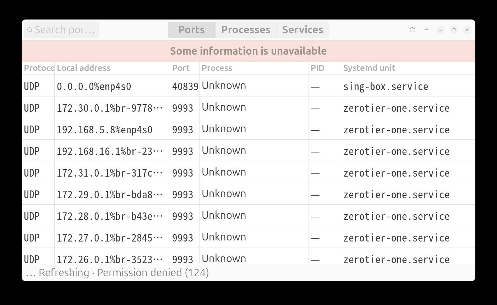
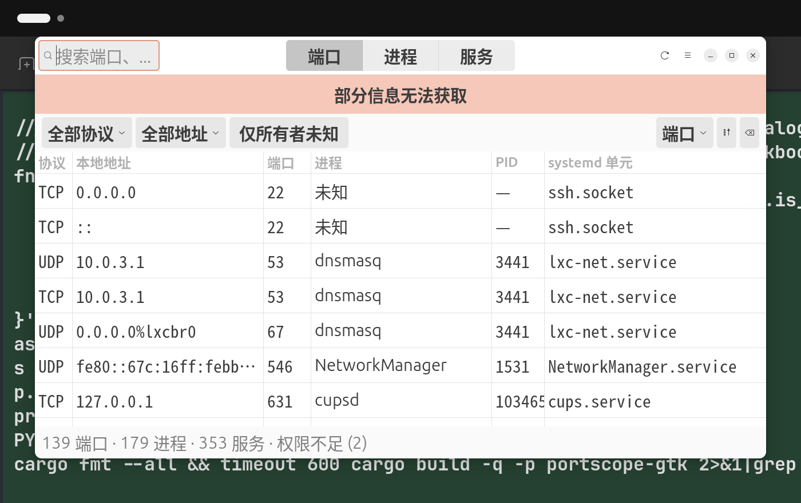

# PortScope

A Linux desktop application for diagnosing **local** ports, processes, systemd
services and journal logs.

PortScope answers a focused question: *which* local endpoints are listening,
*which* process owns each one, *which* systemd unit that process belongs to, and
what the journal says about it — **and what the evidence is** for each link.

It runs entirely as the invoking user. No root, no `sudo`, no polkit, no
telemetry, no network access.

<!-- Screenshots are real captures of the running application. -->
| Ports (English) | Ports (简体中文) |
| --- | --- |
|  |  |

---

## Status — read this before installing

**This is a development snapshot (0.1.0), not a finished release.**

Implemented and verified on Ubuntu 24.04 / GNOME 46 / X11:

- Collection of TCP/UDP endpoints (IPv4 + IPv6), owning processes and units.
- Evidence-based endpoint↔service association. **Never** guessed from a port
  number or a process name.
- Ports / Processes / Services views with search, filtering and sorting.
- Details pane showing the raw evidence behind each association.
- Journal display with severity filtering, text search and per-entry copy.
- English and Simplified Chinese, switchable at runtime, preference persisted.
- Settings window, light and dark themes, responsive layout down to 1024×600.
- Diagnostic summary export that excludes full command lines.

**Not yet verified or not implemented** — see [Known limitations](#known-limitations).
In particular: **Wayland is untested**, **Debian 13 is untested**, and no
distribution packages exist yet.

---

## Install

### From source (recommended for now)

Requirements:

| Dependency | Minimum | Verified with |
| --- | --- | --- |
| Rust | 1.85 | 1.94.1 |
| GTK | 4.14 | 4.14.5 |
| libadwaita | 1.5 | 1.5.0 |
| systemd | 255 | 255 |
| iproute2 (`ss`) | 6.1 | 6.1.0 |
| gettext | any | 0.21 |

On Ubuntu 24.04 / Debian:

```bash
sudo apt install libgtk-4-dev libadwaita-1-dev gettext build-essential
```

> Note: the distro `rustc` on Ubuntu 24.04 is 1.75, which is **too old**. The
> dependency tree already requires 1.85. Install a current toolchain with
> [rustup](https://rustup.rs/).

Build and install into your own prefix (no root needed):

```bash
git clone <repository>
cd portscope

cargo build --release -p portscope-gtk -p portscope-cli
./scripts/install.sh            # installs to ~/.local
```

If `~/.local/bin` is not on your `PATH`, add it:

```bash
export PATH="$HOME/.local/bin:$PATH"
```

Then start **PortScope** from your application menu, or run:

```bash
portscope
```

### System-wide

```bash
PREFIX=/usr sudo -E ./scripts/install.sh
```

---

## Uninstall

```bash
./scripts/uninstall.sh              # removes the installed files
./scripts/uninstall.sh --purge      # also removes saved settings
```

The uninstaller removes only what `install.sh` created. Your settings in
`~/.config/portscope` are kept unless you pass `--purge`.

---

## Permissions — what you can and cannot see

PortScope never asks for privileges. As a normal user:

| Data | Availability |
| --- | --- |
| Listening endpoints (address, port, state) | **always** |
| Socket owner UID and cgroup | **always** (`ss -e` exposes these) |
| Owning process for *your* processes | **always** |
| Owning process for *other users'* processes | **usually** — recovered via the socket's cgroup, which is world-readable |
| System journal | **only if** you are in `adm` or `systemd-journal` |
| `/proc/<pid>/cmdline` for other users | only without `hidepid` |

When something is unavailable the UI **says so** — it never shows an empty list
and lets you believe there was nothing there.

`PortScope` will **not** add you to any group. If you want system logs, that is
your decision to make:

```bash
sudo usermod -aG adm "$USER"   # then log out and back in
```

---

## How associations work

An endpoint is linked to a service **only** through observable evidence,
strongest first:

| Rank | Evidence | How it is obtained |
| --- | --- | --- |
| 1 | Socket inode in `/proc/<pid>/fd` | `ss -e` inode → process fd table |
| 2 | cgroup match | socket `cgroup:` → `/sys/fs/cgroup/<unit>/cgroup.procs` |
| 3 | `MainPID` match | endpoint owner PID = unit `MainPID` |
| 4 | Socket activation | `.socket` unit `Triggers=` names the service |
| 5 | `Listen=` match | unit `Listen=` address:port matches the endpoint |

PortScope **never** concludes that port 22 belongs to `ssh.service` because of
the port number, the process name, or the unit description. When there is no
evidence it says *no confirmable association*.

The details pane shows the evidence that produced each link, e.g.

```
CgroupUnitMatch: cgroup:/system.slice/zerotier-one.service
```

---

## Keyboard

| Shortcut | Action |
| --- | --- |
| `Ctrl+F` | focus the search field |
| `Ctrl+R` | refresh now |
| `Esc` | leave the details page (narrow layout) |

---

## Development

```bash
cargo test -- --test-threads=1            # 137 tests, no display server needed
cargo fmt --all --check
cargo clippy --workspace --all-targets -- -D warnings
cargo run -p portscope-cli -- snapshot    # reproducible diagnostic snapshot
```

Layout:

```
crates/core   GTK-free: model, collection, association, errors
crates/cli    GTK-free: snapshot / journal / compare-backends
crates/gtk    GTK 4 + libadwaita front end
```

The core is deliberately GTK-free so every association rule is testable without
a display server.

Translations live in `crates/gtk/po/*.po`. To update:

```bash
msgfmt --check-format -o /tmp/check.mo crates/gtk/po/zh_CN.po
```

More detail: [`docs/ARCHITECTURE.md`](docs/ARCHITECTURE.md),
[`docs/TESTING.md`](docs/TESTING.md),
[`docs/STATUS.md`](docs/STATUS.md) (authoritative state).

---

## Known limitations

Stated plainly, because shipping these silently would be dishonest:

| Limitation | State |
| --- | --- |
| **Wayland** | **Untested.** Only X11 was available. This is a release gate. |
| **Debian 13** | **Untested.** Needs a real host or VM. Release gate. |
| **Distribution packages** | `.deb` / `.rpm` / Flatpak do **not** exist yet. |
| **CI** | No automated pipeline yet. |
| Fractional scaling (125 % / 175 %) | Untested; the session only offers 100/200 %. |
| `hidepid=2` | Untested on a real host. The code treats `/proc` reads as failable. |
| System journal for non-`adm` users | Shown as a permission notice, not as an empty log. |
| Killing processes / starting units | **Not implemented, by design.** |
| Container/Kubernetes aware | **Out of scope.** A socket with no `uid` is reported as *unknown owner*, never assumed to be a container. |

---

## Licence

MIT — see [`LICENSE`](LICENSE).
